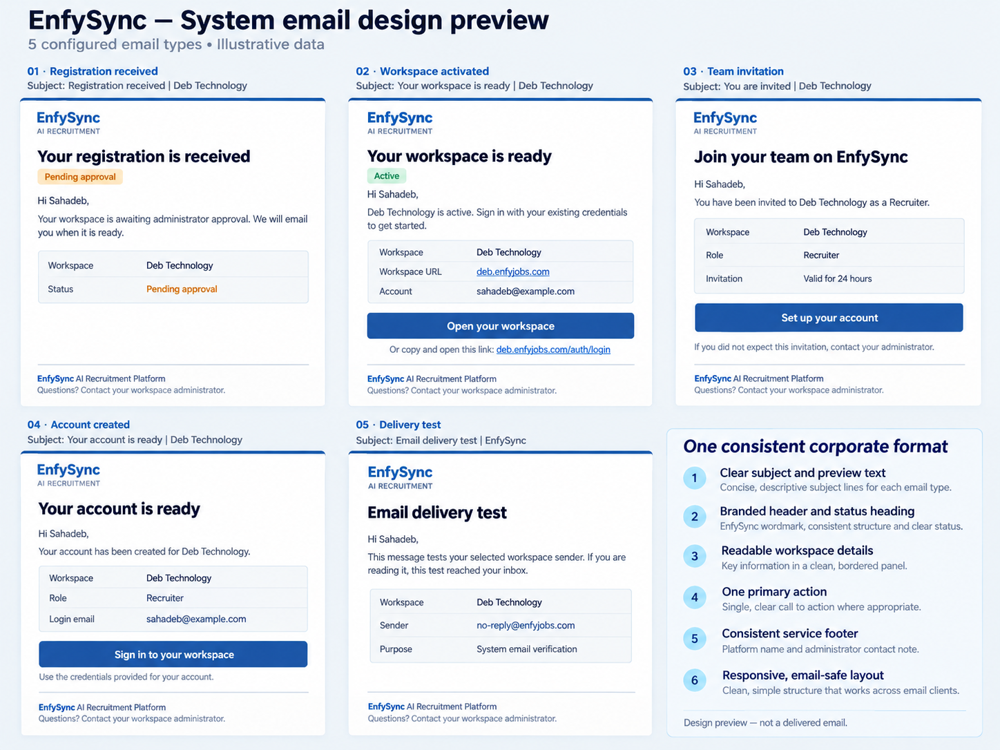

# System Design Proposal

## Corporate system email formatting

Status: approved and implemented locally. Five shared corporate templates include the automatic-email disclaimer. No production rollout of this formatting update has been performed.

Validation: 82 email/authentication tests passed across seven suites; backend and frontend TypeScript checks and shared-contract synchronization passed. Actual HTML and plain-text previews are available in email-design/index.html. Automated tests verify escaping, action URL validation, invitation copy, optional credentials, and sender-dependent reply instructions. Browser preview inspection could not be completed because the local preview server timed out in the in-app browser; real Gmail/Outlook rendering remains to be verified.

Footer disclaimer on all five messages: “This email was automatically generated by EnfySync. For assistance, contact your workspace administrator.” For a no-reply sender without an explicit Reply-To address, add: “Please do not reply to this email.”

## Current Architecture Context

The backend currently has **five distinct email types**, implemented through four template-producing methods/routes. Tenant-selected delivery uses SystemMailService, with Brevo as the platform default. The screenshot confirms delivery, but the activation email consists of a heading, two paragraphs, and a bare link. Invitations, account creation, and tests have independent HTML styles and inconsistent branding; there is no shared presentation layer or plain-text alternative in SystemEmailRequest.

| Email type | Existing trigger | Proposed subject | Primary action |
|---|---|---|---|
| Registration received | Public tenant registration; pending approval | EnfySync — Registration received · {workspace} | None; explain approval and next notification |
| Workspace activated | Platform approval OR manually created active tenant | EnfySync — Your workspace is ready · {workspace} | Open your workspace |
| Team invitation | Administrator invites a member | EnfySync — Invitation to join {workspace} | Set up your account |
| Account created | Member registration/account creation | EnfySync — Your account is ready · {workspace} | Sign in to your workspace |
| Delivery test | Administrator selects Send Test Email | EnfySync — Email delivery test | None; explain what the test verifies |

These are five templates across six event paths because activation has two triggers. Count excludes marketing campaigns, personal recruitment mail, and Keycloak-managed verification/password-reset emails. No new notification events are proposed.

Sources inspected: ats_backend/src/auth/services/auth-email.service.ts; auth-tenant.service.ts; auth-invite.service.ts; auth-core.service.ts; src/email/email.controller.ts and system-mail.service.ts.

## Proposed Solution

### Shared presentation

Use a white email card with a 600px maximum width, pale slate outer background, thin blue top rule, and EnfySync header. Use Arial/Helvetica/system fallbacks, a 24px primary heading, 15px body with generous line height, and a 12px footer. Corporate blue (#1e4e98), restrained cyan accent, dark slate copy, subtle borders, and status text support the existing brand. Email readability determines the scale; dashboard table font sizes are not applied to messages.

Every email contains a hidden inbox preview line, branded header, event heading, personalized greeting, concise event-specific content, a workspace details panel when useful, and the same service footer. Active accounts and invitations receive one primary action with a usable URL fallback. Pending registration and delivery tests have no unnecessary action button.

Footer: “EnfySync AI Recruitment Platform” and “Questions? Contact your workspace administrator.” Include workspace context and the current year. Do not invent a support mailbox, postal address, social links, or privacy/support URLs. Only describe a sender as unmonitored if the configured sender/reply-to policy warrants it. Transactional service messages should not get marketing unsubscribe text.

The attached visual is illustrative, not proof of inbox rendering. It shows all five formats using Deb Technology and example contact data. A wordmark remains readable when images are blocked; any existing approved logo must use a public HTTPS asset with alt text and explicit dimensions.

### Content by event

1. **Registration received:** acknowledge the saved registration, show workspace name and pending status, explain that another email follows activation. Do not imply immediate access or promise approval timing.
2. **Workspace activated:** state that access is available, display workspace URL and login email, direct the recipient to the tenant login URL. Use existing credentials; no onboarding password disclosure.
3. **Team invitation:** show workspace and assigned role, make account setup the primary action, state the existing 24-hour expiry, and explain what to do if unexpected. Show social sign-in only when actually enabled by the tenant authentication policy; do not universally promise Google/Microsoft access.
4. **Account created:** show workspace, role, and login email with a sign-in action. The preview deliberately omits passwords. Existing member creation can currently email a supplied password; this formatting change must not silently remove required access instructions or claim it expires/forces a change without implementation evidence. Preserve existing behavior in the first formatting pass; replacing emailed passwords with one-time setup links needs a separately reviewed authentication change.
5. **Delivery test:** explain that reading this email confirms receipt of this test, not delivery guarantees for future emails. Include workspace context and only the actual selected sender when available, not a hardcoded platform sender for custom/Microsoft/SMTP tenants. Avoid transport implementation jargon in recipient-facing content.

### Backend implementation

- Introduce a backend-owned typed renderer with a discriminated event union for the five templates. It returns subject, preheader, HTML, and plain-text content. All dynamic text is escaped; links are separately validated against configured application/workspace origins.
- Use table-based presentation and inline styles. No JavaScript, external web fonts, CSS-grid reliance, or essential information supplied only through images. Mobile layout is fluid with practical spacing; buttons work in Outlook and Gmail.
- Replace the separate HTML bodies in AuthEmailService and the test route with the renderer. Resolve trusted workspace fields on the server; avoid additional per-field database lookups.
- Add an optional plain-text body to SystemEmailRequest; pass it to Brevo textContent, SMTP text, and a compatible Microsoft Graph body representation. Graph supports one message body: retain the HTML body there rather than claiming a multipart alternative is supported by this request.
- Keep the canonical backend contract and regenerate its frontend copy with docs/sync-email-contract.cjs. There are no database schema changes and no new settings APIs.
- Preserve tenant sender selection, permissions, reply-to, notification acceptance/failure handling, and the existing repeated-approval guard. Rendering failures must not become false provider successes.

## Security & Performance Audit

- [x] No credentials, tokens, or rendered message bodies in logs or design fixtures.
- [x] No change to backend capability checks or tenant ownership enforcement.
- [x] No fabricated tenants, provider acceptance, configured senders, support addresses, or verification status.
- [x] Dynamic content escaped; action URLs validated and invitation tokens encoded.
- [x] Shared typed renderer prevents copy/style drift; public contracts remain synchronized.
- [x] No schema migration; existing transactional event calls remain in place.
- [x] Rendering occurs in memory with no provider call for layout and no N+1 lookup pattern.
- [x] Existing timeout behavior, no ambiguous automatic retry, and sanitized delivery errors remain intact.
- [x] Tenant-specific authentication policy governs any advertised sign-in methods.

## Verification & Rollout

Validate all five event payloads, escaping of hostile workspace/person names, valid links, invitation expiry copy, optional credentials, custom sender metadata, and plaintext conversion. Run existing email/authentication tests, both TypeScript checks, and contract synchronization. Inspect desktop/mobile HTML previews, then send explicitly authorized real previews to a controlled mailbox for Gmail/Outlook review. A generated image is a design reference, not an email-client compatibility test.

After approval, implement and review the five templates. Production rollout uses the existing deployment process after checks; rollback restores the previous backend image without changing account data, sender credentials, or database history. Keycloak templates remain a clearly separate future integration.

## Approval

Do you approve this system design proposal? Should I proceed with the implementation?
