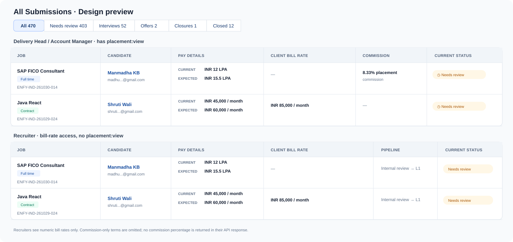

# System Design Proposal: Candidate pay and client rate in submissions

## Current architecture context

The submissions tracker already returns job type and candidate current/expected compensation, currency, and period. The frontend has a formatter for those values, including legacy candidate CTC values. The tracker list query does not currently return client bill rate.

The job detail endpoint requires `job:view`, maps the job's client bill/commission data into its response, and selects the job row with `j.*`. The seeded Recruiter permission bundle has `job:view` but not `placement:view`. This means the interface can hide commission while the current job response may still include it; UI-only hiding would not protect the data.

## Proposed solution

- Add **Pay details** and **Client rate** side by side in the All Submissions table.
- **Pay details** shows Current and Expected candidate pay, with the stored unit: annual/CTC for full-time records and monthly for contract records. Keep values in their recorded currency and period; show **Not recorded** when missing or unitless. Do not convert between currencies or periods.
- **Client rate** shows the recorded bill rate/range with currency and period when present. A placement commission is a separate commercial field, not a bill rate.
- Add a granular `job:bill_rate:view` permission for client bill rates, assign it to the default Recruiter bundle and other business roles that should see numeric bill rates. Gate it in both the frontend and backend. Respect each user's existing tenant, branch, and assigned-job scope.
- Reveal placement commission only to users with the existing `placement:view` permission. The default Recruiter bundle does not have this permission, so recruiters never receive or see the commission value. If a job has a commission but no client bill rate, show an em dash for recruiters; do not reveal a percentage or a commission-specific placeholder.
- Split bill-rate and commission fields in the API response. Extend the existing tracker query with the job commercial fields needed for the table; do not fetch per submission. Audit job detail/list responses and stop returning commission to callers without `placement:view` (including the existing `j.*` response path).
- Keep the new commercial columns non-sortable across mixed currencies and periods. Existing table sorting, filters, and paging stay unchanged.
- No new database columns or compensation data copies are needed; job commercial terms and candidate-submission pay values already exist.

## Security & performance audit

- [x] `job:bill_rate:view` controls numeric client bill rates; `placement:view` controls commission percentages. Do not use hardcoded role-name checks.
- [x] Enforce both permissions in backend responses; frontend checks only control presentation.
- [x] Preserve tenant, branch, and assigned-job authorization scopes.
- [x] Remove commission from `job:view` responses unless the caller has `placement:view`; avoid leaking it through raw job row serialization.
- [x] One existing paginated query supplies table values. No per-row API calls, joins, or schema expansion are required.
- [x] Do not normalize rates across currency or period for display or sorting.

## Visual preview

Illustrative full-time and contract rows are shown for both permission variants. The recruiter preview includes a numeric client bill rate but no commission; when only a commission exists, the client-rate cell is blanked with an em dash. Image generation is unavailable in this session, so this is a lightweight layout mockup rather than a generated photo-style image.

