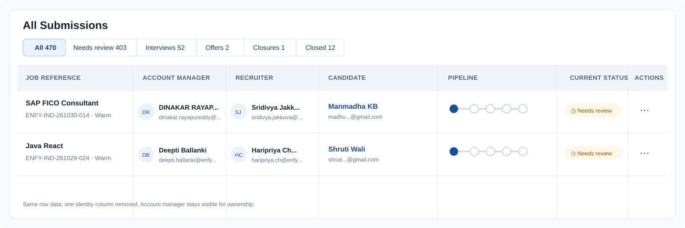

# System Design Proposal: Remove duplicate submission owner column

## Current architecture context

The All Submissions table renders **Created by** (`creatorName` / `creatorEmail`) and **Account manager** (`accountManagerName` / `accountManagerEmail`) as separate columns. They are distinct fields, but often display the same person, as in the supplied screenshot. The table columns are defined in `ats_frontend_main/components/submissions/tracker-columns.tsx`; cells are rendered by `ats_frontend_main/app/(dashboard)/utility/submissions/page.tsx`. There is no column chooser in this page.

## Proposed solution

- Keep **Account manager**, which directly communicates the assigned client owner and supports opening that person's profile.
- Remove **Created by** from the table layout and its default column order. This removes the repeated identity while retaining the manager context delivery teams need.
- Keep creator fields in the API contract and submission details for audit and traceability. Do not change backend, database, access control, or filters.
- Migrate existing saved column order safely: omit `creator`, retain the user's remaining order, and keep **Actions** last. No data or permissions are changed.
- With one fewer column, the table becomes narrower and more of the candidate/pipeline information fits in the viewport.

## Security & performance audit

- [x] No database or API changes; no new data exposure.
- [x] Existing permission checks and profile actions remain unchanged.
- [x] No additional requests, client-side joins, or query work.
- [x] Existing creator information remains available in the detail/audit context.
- [x] Existing per-user saved column preferences are migrated without discarding their remaining order.

## Visual preview

The preview below keeps **Account manager** and removes **Created by**. It is a lightweight layout mockup rather than a generated photo-style image because image generation is unavailable in this session.

