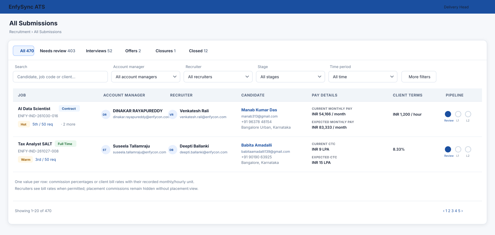

# System Design Proposal

## Submission table clarity: people, job type, and client terms

### Current architecture context

- The submission tracker already receives account manager and recruiter names/emails from the backend and renders them with the shared `UserIdentity` component. Its table-size style truncates email text with CSS ellipsis, which explains why users cannot read the full addresses.
- The job row already receives `jobType`, but the table shows the title, urgency, submission ordinal, and required count without showing the employment type.
- The submission API already returns the candidate pay details, numeric client bill-rate fields, and (permission-gated) placement commission percentage. The frontend currently renders separate `Commission` and `Client bill rate` columns.
- In the India staffing job form, `taxTerms === "Permanent"` selects placement commission; other terms use client bill rate. The backend parser stores a percentage only when the entered client bill rate string is a placement commission. The submission API returns that stored percentage only to users with `placement:view`; numeric bill rates are gated by `job:bill_rate:view`.

### Findings about the commission values in the screenshot

The code does not derive commission from a job being contractual. It returns a commission when the job record has `placement_commission_pct`; the form's permanent-placement path stores this value. A blank dash means the API returned no commission value (or the viewer lacks commission permission). In the screenshot, monthly pay on the first row alongside a dash and `8.33%` on later rows is consistent with contract bill-rate terms versus permanent-placement commission, but the live row data is not available in this workspace to confirm each job's stored `jobType`, `taxTerms`, and commercial fields.

The screenshot also lacks a visible `Client bill rate` column. The API response already includes it for authorized users, so the likely causes are the active user's `job:bill_rate:view` capability or their saved column visibility; verify those before concluding the rate is missing from the job data. The preview keeps bill rate and commission separate to make the distinction explicit.

### Proposed solution

1. Keep the shared avatar/name/email component. Add an opt-in email-wrapping presentation for the submission table so each email wraps across lines instead of being ellipsized. Leave other `UserIdentity` uses unchanged.
2. Show the job type as a compact, suitably colored badge immediately after the job title on the same line, using the exact recorded type (`Full Time`, `Part Time`, `Contract`, `C2H`, `Freelance`, etc.). Keep the canonical title unchanged. Allow the title and badge to wrap as a unit when the job title is long, while keeping urgency and concise submission progress together on the metadata line below.
3. Replace the verbose submission metadata with a concise `5th / 50 req` indicator. Preserve a descriptive accessible label/title for screen readers and hover.
4. Keep a single `Client terms` column. Display one plain text value derived from what is actually stored:
   - Percentage commission: `8.33%`.
   - Monthly bill rate: `INR 65,000 / month`.
   - Hourly bill rate: `INR 1,200 / hour`.
   - If no value is recorded or the viewer lacks permission to see the available value, show a dash.
   Do not combine the percentage with the bill-rate unit or infer a commission period. The percentage is the placement commission; monthly/hourly is the bill-rate unit.
5. Retain the existing granular permission gates. `job:bill_rate:view` controls numeric bill rates; `placement:view` controls commission. The API must continue omitting unauthorized values, regardless of the frontend column label or job type.
6. Confirm the visible column is enabled for the current account. A permission or per-user column preference can hide it; the UI should not silently imply a rate is absent when it is merely unavailable.

### API and data impact

- No database schema change is needed.
- No extra request is needed; all required fields already come from the batched submission-list response.
- The API mapping remains the authority for commission and bill-rate visibility. The UI uses existing `jobType`, compensation units, and permission-filtered commercial fields.
- Confirm actual production rows by inspecting `job_type`, `tax_terms`, `client_bill_rate_min/max`, `client_bill_term`, and `placement_commission_pct` for the affected job IDs. Do not convert a stored commission into a bill rate or vice versa based only on the job-type label.

### Security and performance audit

- [x] No role-name access checks; retain explicit capabilities (`job:bill_rate:view`, `placement:view`).
- [x] No new endpoint, query, or per-row fetch.
- [x] No client commission value reaches a recruiter without `placement:view`.
- [x] The shared identity component changes only through an opt-in style variant.
- [x] Existing fields are sufficient; avoid denormalized or duplicate data.
- [x] A single client-terms column renders the stored percentage or the bill rate with its recorded unit; no period is fabricated for commission.
- [ ] Confirm each affected live record against the persisted job and commercial values before interpreting a particular row as misclassified.

### Preview

Illustrative design only. The attached reference screenshot was used for EnfySync's blue header, neutral table, typography, and dense recruiting workflow. A raster image-generation tool is unavailable in this session, so the preview is provided as a crisp, code-native SVG rather than a generated photo-style mockup.

### Approval

The proposed change alters the table's client-commercial columns and the shared identity component's optional rendering. Please approve this proposal before implementation.
